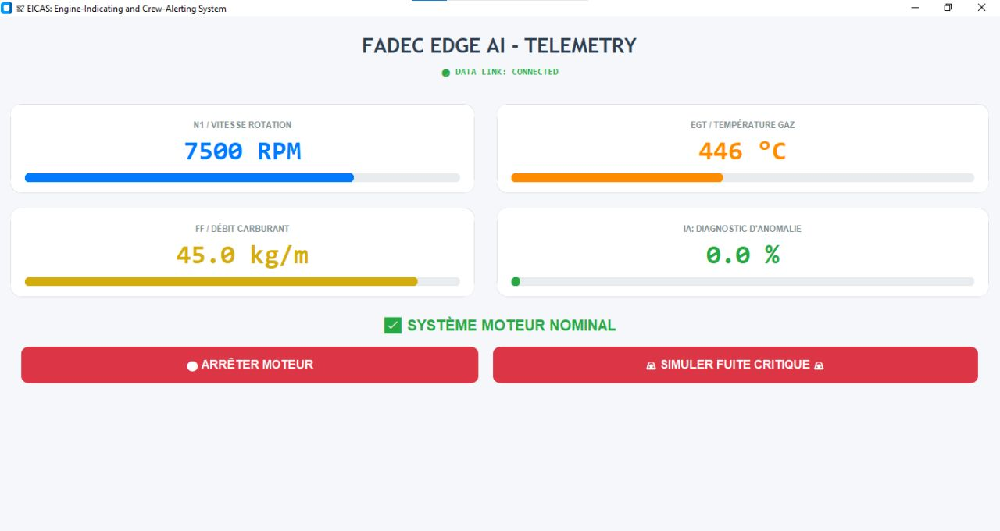
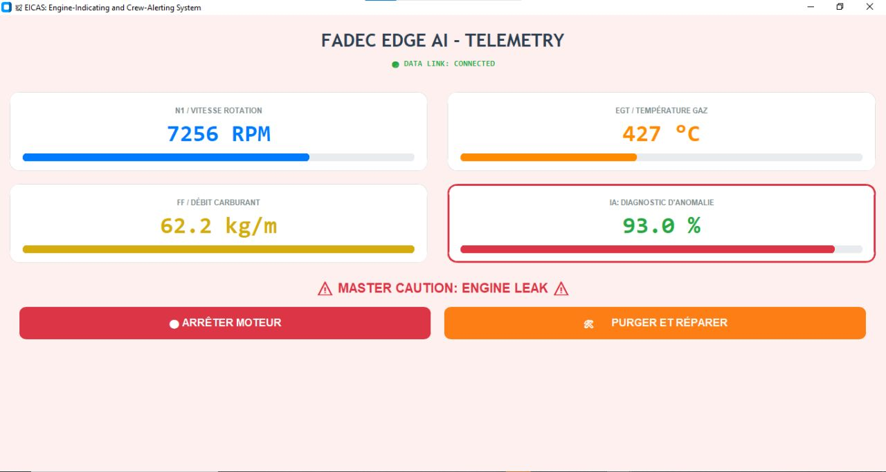

# FADEC Digital Twin — Jumeau numérique, régulation et diagnostic sur STM32

**STM32L475 · C embarqué · FreeRTOS · Régulation PID · TinyML / X-CUBE-AI · Wi-Fi / MQTT · Python**

## Pourquoi ce projet ?

Sur un système moteur, commander une grandeur et surveiller son comportement sont deux problèmes complémentaires. Une variation de consigne doit être suivie par le système ; une anomalie peut, au contraire, modifier sa réponse. Ce projet personnel est né de l'envie d'explorer **ces deux aspects sur une même plateforme embarquée**, en ajoutant une supervision accessible depuis un ordinateur.

L'objectif était de construire sur **STM32L475** un **prototype de moteur aéronautique simulé** capable de **suivre une consigne de régime**, de **reproduire une fuite de carburant**, d'**analyser l'état du moteur avec un petit réseau de neurones** et de **transmettre les résultats vers une interface Python**.

Ce travail réunit plusieurs facettes des systèmes embarqués : **développement firmware en C**, modélisation, **contrôle-commande**, **FreeRTOS**, **IA embarquée**, communication réseau et supervision. Le C constitue la base de l'intégration, mais ce n'est pas l'unique sujet du projet.

**[Voir les captures de démonstration](#démonstration-de-la-supervision)** · **[Explorer le code STM32](Core/Src/)** · **[Voir le notebook IA](train_fadec_model.ipynb)**

> **Périmètre :** démonstrateur expérimental basé sur un modèle logiciel simplifié. Ce n'est ni un moteur réel instrumenté, ni un calculateur FADEC certifié.

## Ce que le prototype permet de faire

Le principe est celui d'une **boucle fermée** : le contrôleur PID compare une consigne au régime simulé et ajuste la commande de carburant. Le moteur virtuel évolue ensuite suivant cette commande : son régime et sa température changent. Les paramètres sont analysés sur le STM32 par le réseau TinyML, puis envoyés au tableau de bord par Wi-Fi/MQTT.

L'application Python permet également d'**envoyer des commandes de démarrage, d'arrêt et d'activation d'une fuite simulée**. Dans ce dernier scénario, le moteur virtuel n'utilise plus toute la quantité de carburant commandée : son comportement évolue et l'interface peut afficher une alerte.

Les **deux captures plus bas** montrent précisément ces états, en fonctionnement nominal puis avec fuite simulée. Elles servent à illustrer le comportement du prototype, sans représenter une validation d'un moteur réel.

## Architecture et circulation des données

```text
              Consigne de poussée
                      |
                      v
               Régulateur PID
                (fadec_core.c)
                      |
                Débit carburant
                      |
                      v
               Modèle moteur
                (engine_sim.c)
                      |
            Régime / Température / Débit
                      |
                      v
             Prétraitement en C
                      |
                      v
          Réseau de neurones X-CUBE-AI
                      |
             Probabilité d'anomalie
                      |
                      v
             JSON -> MQTT / Wi-Fi
                      |
               Supervision distante
```

Une fuite de carburant peut être injectée dans le modèle pour modifier son comportement et tester la chaîne de détection. Les modules de commande, de simulation et de communication sont séparés dans le code.

## Compétences mises en pratique dans le code

| Domaine | Réalisation et code associé |
| --- | --- |
| **Ordonnancement sous FreeRTOS** | [`main.c`](Core/Src/main.c) : création de `SimTask` (priorité haute), `FadecTask` (normale) et `MqttTask` (basse) ; délais programmés de **10 / 20 / 500 ms** |
| **Commande et régulation** | [`fadec_core.c`](Core/Src/fadec_core.c) : correcteur **PID**, mémoire de l'erreur, limitation de l'intégrale et saturation de la commande entre 0 et 100 % |
| **Simulation numérique** | [`engine_sim.c`](Core/Src/engine_sim.c) : évolution du régime, température, décélération à l'arrêt et scénario de fuite de carburant |
| **Programmation des périphériques STM32** | [`hardware_io.c`](Core/Src/hardware_io.c) : **ADC**, timer **PWM**, callback d'interruption **GPIO/EXTI** pour la demande d'arrêt |
| **Communication réseau en C** | [`wifi_mqtt.c`](Core/Src/wifi_mqtt.c) : utilisation de l'interface Wi-Fi/TCP, construction manuelle de trames MQTT **CONNECT / SUBSCRIBE / PUBLISH**, buffers statiques et sérialisation **JSON** |
| **IA intégrée au firmware** | [`wifi_mqtt.c`](Core/Src/wifi_mqtt.c) : normalisation des entrées, buffers du réseau X-CUBE-AI, appel à `ai_network_run()` et émission de la télémétrie |

**Ce que le projet démontre :** intégrer sur une même cible une simulation numérique, une boucle de régulation, un réseau de neurones et une communication distante. Cette intégration s'appuie sur du **firmware modulaire en C**, l'ordonnancement FreeRTOS et une interface de supervision Python.

Les tâches utilisent des délais configurés dans FreeRTOS : **il ne s'agit pas de périodes d'exécution mesurées ni d'une garantie temps réel**. Le client MQTT est une implémentation simplifiée destinée à la démonstration, et non une pile réseau industrielle complète.

## Fonctionnalités implémentées

### 1. Simulation moteur en C

Le fichier [`engine_sim.c`](Core/Src/engine_sim.c) implémente un modèle empirique :

- évolution du régime de rotation en fonction du débit de carburant et d'un terme de traînée ;
- échauffement et refroidissement de la température simulée ;
- décélération progressive lors de l'arrêt ;
- simulation d'une fuite réduisant le carburant effectivement utilisé.

Les paramètres de ce modèle sont des coefficients de simulation. Il ne s'agit pas d'une modélisation thermodynamique validée sur un moteur réel.

### 2. Régulation et interface matérielle

Le fichier [`fadec_core.c`](Core/Src/fadec_core.c) calcule une commande par **PID**, limitée entre 0 et 100 %, avec un bornage du terme intégral.

Le module [`hardware_io.c`](Core/Src/hardware_io.c) regroupe les appels aux périphériques STM32 : lecture ADC, commande par timer/PWM et prise en compte d'un bouton d'arrêt. L'interface PWM représente ici une commande de démonstration et non le pilotage d'une vanne aéronautique réelle.

### 3. Organisation sous FreeRTOS

Dans [`main.c`](Core/Src/main.c), plusieurs tâches sont créées avec des priorités différentes :

| Tâche | Fonction | Délai configuré |
| --- | --- | --- |
| `SimTask` | Mise à jour du modèle moteur | 10 ms |
| `FadecTask` | Régulation PID et interface matérielle | 20 ms |
| `MqttTask` | Inférence, publication et réception MQTT | 500 ms |

Ces valeurs sont les délais demandés par le programme ; **ce ne sont pas des mesures de temps d'exécution, de latence ou de jitter**.

### 4. Inférence IA sur STM32

Le fichier [`wifi_mqtt.c`](Core/Src/wifi_mqtt.c) prépare trois valeurs d'entrée (régime, température et débit), applique une normalisation en C et appelle le réseau généré par **STM32 X-CUBE-AI**.

La sortie du modèle est comparée à un seuil de 0,5 pour produire un indicateur d'alerte.

Selon le [rapport de génération X-CUBE-AI](X-CUBE-AI/App/network_generate_report.txt) fourni avec ce dépôt :

| Caractéristique du réseau | Valeur |
| --- | --- |
| Architecture | 3 entrées → 8 → 4 → 1 sortie |
| Format du modèle généré | **Float32** |
| Paramètres | 292 octets |
| Mémoire d'activation | 48 octets |
| Opérations | 95 MACC |

Les chiffres ci-dessus décrivent **le réseau généré**, pas la mémoire RAM/Flash totale du firmware ni une mesure de vitesse d'inférence sur carte.

### 5. Communication Wi-Fi / MQTT

Le code utilise le module Wi-Fi Inventek ISM43362 et réalise des échanges MQTT sur une connexion TCP :

- publication de télémétrie JSON (régime, température, débit, score et alerte) ;
- réception de commandes de démarrage, d'arrêt et d'injection de fuite ;
- échange avec un broker MQTT public dans la configuration de démonstration.

Le client MQTT est une implémentation expérimentale simplifiée. Il ne doit pas être considéré comme une pile MQTT complète ou sécurisée.

## Matériel et outils

- **Cible :** microcontrôleur STM32L475 (ARM Cortex-M4), module Wi-Fi Inventek ISM43362 ;
- **Firmware :** C, HAL STM32, FreeRTOS / CMSIS-RTOS2 ;
- **IA embarquée :** STM32 X-CUBE-AI, modèle TensorFlow Lite intégré ;
- **Réseau :** TCP, MQTT, messages JSON ;
- **Développement :** STM32CubeIDE / STM32CubeMX, GNU Arm Embedded Toolchain, GitHub Actions.

## Structure du dépôt

| Chemin | Contenu |
| --- | --- |
| `Core/Src/engine_sim.c` | Modèle moteur et simulation de panne |
| `Core/Src/fadec_core.c` | Correcteur PID |
| `Core/Src/hardware_io.c` | Abstraction des périphériques STM32 |
| `Core/Src/wifi_mqtt.c` | Wi-Fi, MQTT et inférence IA |
| `Core/Src/main.c` | Initialisation et tâches FreeRTOS |
| `Core/Inc/` | Interfaces et configuration |
| `X-CUBE-AI/App/` | Code du modèle généré et rapport technique |
| `FADEC_DigitalTwin.ioc` | Configuration STM32CubeMX |
| `.github/workflows/build.yml` | Compilation automatisée |

Le dépôt inclut également des composants et bibliothèques de STMicroelectronics et de l'écosystème STM32. Ils ne constituent pas tous du code développé spécifiquement pour ce projet.

## Compilation

Le projet fournit un fichier de configuration CubeMX et un `Makefile`. Il peut être ouvert avec l'environnement STM32 correspondant.

Pour compiler avec la chaîne GNU Arm Embedded correctement installée :

```bash
make -j
```

Un [workflow GitHub Actions](.github/workflows/build.yml) compile le firmware et archive les fichiers produits. Une compilation réussie ne remplace pas les essais de fonctionnement sur la carte.

**Configuration réseau locale :** copier le modèle de configuration, puis renseigner le SSID et le mot de passe **uniquement dans le fichier local ignoré par Git** :

```bash
cp Core/Inc/secrets_example.h Core/Inc/secrets.h
```

Modifier ensuite `Core/Inc/secrets.h` avant de compiler. La CI emploie automatiquement une configuration factice tirée du modèle. **Important :** d'anciens commits contiennent des identifiants Wi-Fi publiés précédemment. Tout mot de passe encore utilisé doit être changé ; retirer le fichier de la branche actuelle ne supprime pas l'historique Git.

## Tableau de bord Python

Le script [`dashboard_fadec.py`](dashboard_fadec.py) utilise **CustomTkinter** et **Paho-MQTT** pour afficher le régime, la température, le débit et le score IA. Il permet d'envoyer des commandes de démarrage, d'arrêt et d'injection de fuite simulée via MQTT.

Installation et lancement depuis la racine du dépôt :

```bash
python -m pip install customtkinter paho-mqtt
python dashboard_fadec.py
```

Le programme se connecte à `broker.hivemq.com:1883` et s'abonne à `stm32/aod/fadec`. Il envoie les commandes sur `stm32/aod/command`. L'application est destinée à une **démonstration sur un broker public non chiffré**, sans confidentialité ni authentification : ne pas utiliser ces topics pour commander un système réel.

À chaque lancement, le script écrit un en-tête CSV dans `fadec_telemetry.csv`, même si ce fichier existe déjà ; ce comportement pourra être amélioré afin d'éviter les en-têtes répétés.

## Démonstration de la supervision

Deux captures du tableau de bord EICAS illustrent le fonctionnement de la supervision sur le prototype STM32. Les images proviennent de la [démonstration publiée sur LinkedIn](https://www.linkedin.com/feed/update/urn:li:activity:7462833268191686657/).

| Fonctionnement nominal | Fuite de carburant simulée |
| :---: | :---: |
|  |  |
| **Moteur simulé en état nominal** | **Alerte de fuite simulée affichée** |

| Paramètre affiché | Fonctionnement nominal | Fuite simulée |
| --- | ---: | ---: |
| Régime moteur | 7 500 tr/min | 7 256 tr/min |
| Température | 446 °C | 427 °C |
| Débit carburant | 45,0 kg/min | 62,2 kg/min |
| Score IA affiché | 0,0 % | 93,0 % |
| État | Système nominal | Alerte de fuite |

Ces valeurs correspondent à **deux instantanés de la simulation**, pas à une campagne de mesures. Le score de **93 %** est la sortie affichée par le modèle pour cet état moteur : **il ne représente pas une accuracy de 93 % sur un jeu de test**. Le tableau de bord affiche artificiellement 0 % lorsque la sortie brute du modèle est inférieure à 45 %.

## Jeu de données de simulation

Le fichier [`dataset_moteur.csv`](dataset_moteur.csv) contient **223 observations** : **39 lignes étiquetées 0 (normal)** et **184 lignes étiquetées 1 (fuite)**. Il comprend les colonnes `Timestamp`, `RPM`, `Temperature`, `Fuel` et `Label_Fuite`.

Les classes sont déséquilibrées et les observations proviennent d'une courte séquence de simulation ; le fichier seul ne suffit pas à établir la performance du réseau de neurones sur des données indépendantes.

## Entraînement et validation du modèle

Le notebook [`train_fadec_model.ipynb`](train_fadec_model.ipynb) permet de réentraîner un classifieur de fuite à partir de [`dataset_moteur.csv`](dataset_moteur.csv). Il regroupe les états moteur strictement identiques avant la séparation entraînement/validation/test, produit les courbes d'apprentissage, calcule les métriques de classification et exporte un modèle TensorFlow Lite **Float32**.

Les entrées suivent l'ordre utilisé dans le firmware : `RPM`, `Temperature`, `Fuel`, normalisées respectivement par `7562.3`, `695.3` et `100.0`. Le réseau utilise l'architecture **3 → 8 → 4 → 1**.

Pour exécuter le notebook localement depuis le dossier du dépôt :

```bash
python -m pip install jupyterlab numpy pandas scikit-learn matplotlib tensorflow
jupyter lab train_fadec_model.ipynb
```

Il peut également être ouvert dans Google Colab, avec `dataset_moteur.csv` chargé dans la session.

**Traçabilité du modèle :** le notebook permet un **nouvel entraînement expérimental**, mais ne reconstitue pas exactement les poids de `fadec_edge_ai_model.tflite` actuellement intégré dans le firmware. Il exporte un fichier séparé, `fadec_edge_ai_model_retrained.tflite`. Aucun remplacement du modèle STM32 n'est effectué automatiquement. Le dataset ne comprend qu'une courte simulation et ne permet pas une évaluation indépendante complète.

## État du projet et pistes d'amélioration

**Présent dans ce dépôt :** firmware C, code généré X-CUBE-AI, modèle `.tflite` embarqué, configuration STM32CubeMX, compilation automatisée, tableau de bord Python, jeu de données de simulation et notebook de réentraînement expérimental.

Le tableau de bord crée son propre fichier de télémétrie `fadec_telemetry.csv`, distinct du dataset `dataset_moteur.csv`.

**Non inclus actuellement :** une démonstration vidéo, le script historique ayant produit les poids du modèle actuellement embarqué et une campagne de validation sur plusieurs sessions indépendantes.

**Améliorations identifiées :**

- retirer les identifiants réseau du code et de l'historique Git ;
- ajouter des essais de validation du modèle moteur et de la régulation ;
- vérifier les échanges et le décodage MQTT sur plusieurs scénarios ;
- documenter l'origine des poids embarqués et valider le modèle sur des acquisitions indépendantes ;
- mesurer les temps de traitement, l'utilisation mémoire et le comportement temporel sur la cible ;
- ajouter une démonstration réelle du montage et de la supervision.

## Auteur

**Amadou Oury Diallo**  
Élève ingénieur en instrumentation et systèmes embarqués  
Sup Galilée — Université Sorbonne Paris Nord

[LinkedIn](https://www.linkedin.com/in/amadou-oury-diallo-0120961a1/)
